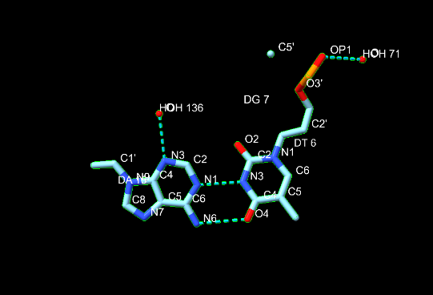
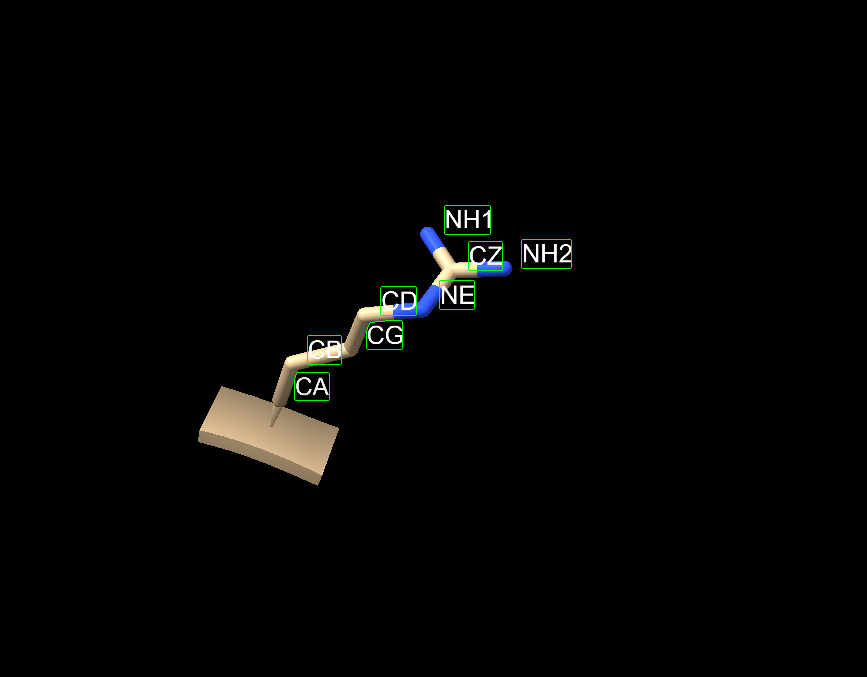

Scientist’s Mission (0153B016 陳瑋嫺)
https://github.com/Lgdlr

# Who Stole TP53’s Superpower? Searching for the Key to Unlock Cancer

## Using AI to Uncover the Secrets of TP53–DNA Interactions

### 1. 【The LEGO Assembly Line】
**What type of bond links amino acids together to form a protein? Which amino acids form hydrogen bonds with each other?**

**Answer:**
Amino acids are linked together by peptide bonds (a type of covalent amide bond) to form polypeptide chains and proteins. These bonds are formed through a condensation (dehydration) reaction between the carboxyl group (-COOH) of one amino acid and the amino group (-NH2) of the next.

- **Backbone Hydrogen Bonds:** The carbonyl oxygen (C=O) and amide hydrogen (N-H) of the peptide backbone in any amino acid can form hydrogen bonds with each other. These drive the formation of secondary structures like α-helices and β-sheets.
- **Side-Chain Hydrogen Bonds:** Amino acids with polar or charged side chains can form hydrogen bonds with each other, with water molecules, or with other ligands. Key amino acids include:
  - Hydroxyl-containing residues: Serine, Threonine, and Tyrosine (-OH groups)
  - Amide-containing residues: Asparagine and Glutamine (-CONH2 groups)
  - Charged/Basic residues: Arginine, Lysine, and Histidine (can donate/accept hydrogen bonds via amino, guanidino, or imidazole groups)
  - Acidic residues: Aspartic acid and Glutamic acid (can act as hydrogen bond acceptors via their carboxylate oxygen atoms)

### 2. 【The Double-Track Highway of Life’s Blueprint】
**How do nucleotides assemble to form double-stranded DNA? What are the basic structural components of DNA? Is DNA right-handed or left-handed? List the names of the four DNA bases. Which bases form hydrogen bonds with each other?**

**Answer:**

### 3. 【Searching for My One-and-Only Soulmate in the Universe: A 20-Base-Pair Love Code Hidden Among 3 Billion DNA Base Pairs】
The source of molecular stability and specificity: hydrogen bonding — How do TP53 and DNA recognize each other?
Using the structure 3KMD, identify one pair of an amino acid and a DNA base that interact with each other.

**Answer:**
In the crystal structure of the p53 core domain bound to its consensus DNA target (PDB ID: 3KMD), sequence-specific recognition is achieved through precise hydrogen bonds and electrostatic interactions between amino acid side chains and specific nucleotide bases in the DNA grooves.

A prominent example of an amino acid-DNA base interaction pair in this structure is:
- **Amino Acid:** Arginine 280 (Arg280)
- **DNA Base:** Guanine (specifically conserved guanine residues in the major groove of the p53 response element)

**How They Interact:**
- **The Mechanism:** The side chain of Arg280 (featuring a positively charged guanidinium group) reaches into the major groove of the DNA double helix.
- **Hydrogen Bonding:** It forms invariant, highly specific hydrogen bonds with the oxygen and nitrogen atoms of the conserved guanine base. This direct read-out allows the p53 tumor suppressor to accurately lock onto its target genes amidst the 3 billion base pairs of the human genome.

*(Another notable interacting pair in p53-DNA structures is Lysine 120 (Lys120), which forms sequence-specific hydrogen bonds with cytosine/thymine bases, or Arginine 248 (Arg248), which contacts the minor groove).*

### 4. 【Return to the Crime Scene】
**Why can a mutation (change) in just one amino acid of a protein sometimes lead to a serious human disease? Give one specific example of such a disease.**

**Answer:**

### 5. 【Return to the Crime Scene: Searching for Clues】
Using the TP53–DNA structure (3KMD), identify one TP53 amino acid mutation that can lead to uncontrolled cell division and contribute to the development of cancer.
Then examine this amino acid in ChimeraX. Based on its three-dimensional position, determine whether the mutated amino acid is located directly at the protein–DNA interface or somewhere else in the protein.

**Answer:**
a. Paste a screenshot of your ChimeraX visualization here.
b. Save your ChimeraX session file as StudentID.cxs.

